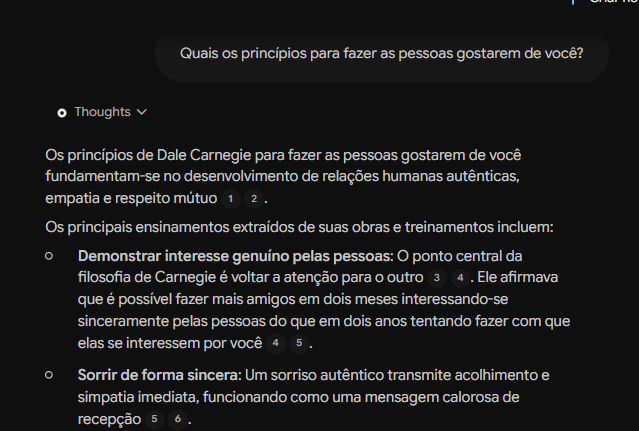
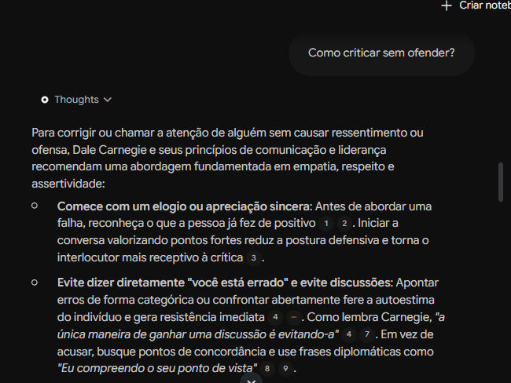
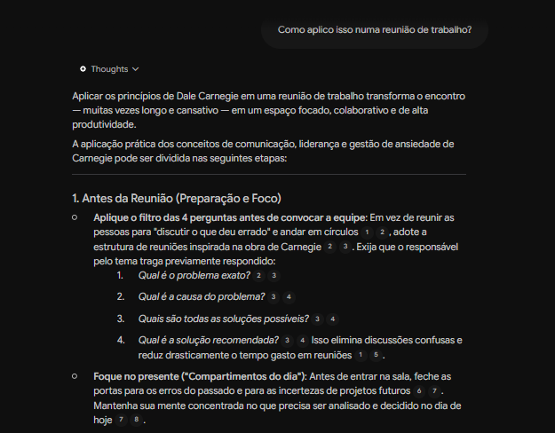
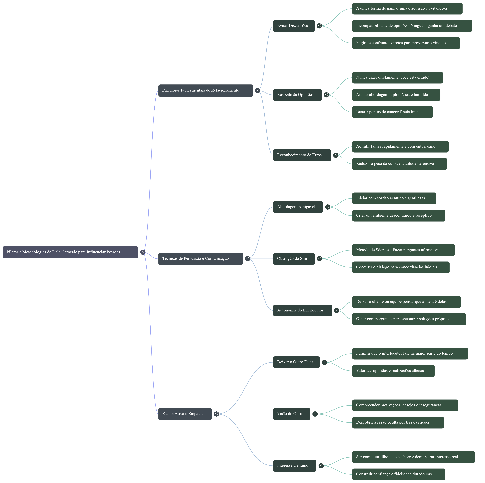
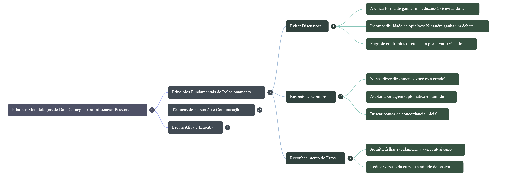
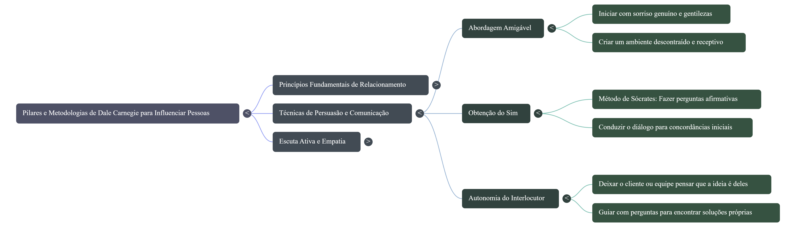
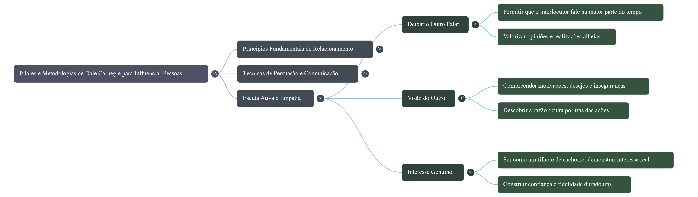

# segundo-cerebro-dale-carnegie

## Meu segundo cérebro no NotebookLM sobre comunicação, baseado nas metodologias de Dale Carnegie: fontes selecionadas, perguntas com citações e materiais gerados.

## Fontes e por que confio nelas
https://www.youtube.com/watch?v=dkvdiuWwwCs
https://www.youtube.com/watch?v=SsPk13embBM
https://www.youtube.com/watch?v=GXXDQ0O7qJk
https://napratica.org.br/noticias/dale-carnegie-conheca-a-historia

Minhas fontes são videos e do youtube e alguns sites que gosto de acompanhar relacionados as obras e biografia de Dale Carnegie.

## Diretriz de comportamento
Tornar-me especialista em comunicação com base nas metodologias de Dale Carnegie, para aplicar em conversas, trabalho e liderança.

## Perguntas e respostas
### 1. Quais os princípios para fazer as pessoas gostarem de você?
**Resposta (Os principais ensinamentos extraídos de suas obras e treinamentos incluem:

* **Demonstrar interesse genuíno pelas pessoas**: O ponto central da filosofia de Carnegie é voltar a atenção para o outro[3][4]. Ele afirmava que é possível fazer mais amigos em dois meses interessando-se sinceramente pelas pessoas do que em dois anos tentando fazer com que elas se interessem por você[4][5].
* **Sorrir de forma sincera**: Um sorriso autêntico transmite acolhimento e simpatia imediata, funcionando como uma mensagem calorosa de recepção[5][6].
* **Saber ouvir e encorajar os outros a falar**: Ouvir com paciência e atenção dá espaço para que as pessoas compartilhem suas experiências, ideias e desejos[4]. Quando o interlocutor se sente compreendido e ouvido, a conexão se fortalece[7][8].
* **Ver as coisas pelo ponto de vista do outro (Empatia)**: Colocar-se no lugar da outra pessoa ajuda a compreender suas preocupações, anseios e motivações[9]. Em vez de julgar ou discordar asperamente, busca-se entender a razão de suas atitudes[9][10].
* **Fazer a outra pessoa se sentir importante**: Reconhecer o valor do outro e demonstrar apreciação sincera atende a uma necessidade humana fundamental de validação e respeito[1].
* **Iniciar com uma abordagem amigável e evitar discussões**: Adotar cordialidade desde o primeiro momento e focar em pontos de concordância cria um ambiente receptivo e evita conflitos desnecessários):** ...

### 2. Como criticar sem ofender?
**Resposta (* **Comece com um elogio ou apreciação sincera**: Antes de abordar uma falha, reconheça o que a pessoa já fez de positivo[1][2]. Iniciar a conversa valorizando pontos fortes reduz a postura defensiva e torna o interlocutor mais receptivo à crítica[3].
* **Evite dizer diretamente "você está errado" e evite discussões**: Apontar erros de forma categórica ou confrontar abertamente fere a autoestima do indivíduo e gera resistência imediata[4]. Como lembra Carnegie, *"a única maneira de ganhar uma discussão é evitando-a"*[4][7]. Em vez de acusar, busque pontos de concordância e use frases diplomáticas como *"Eu compreendo o seu ponto de vista"*[8][9].
* **Fale sobre os seus próprios erros antes de criticar**: Demonstrar que você também já cometeu equívocos semelhantes ajuda a humanizar a conversa e diminui o peso da correção[10].
* **Faça perguntas em vez de dar ordens ou acusar**: Conduza o diálogo fazendo perguntas que levem a pessoa a refletir sobre o erro e chegar à solução por si mesma[13]. As pessoas se comprometem muito mais com conclusões e ideias que sentem ter construído juntas[16][17].
* **Preserve a dignidade da pessoa e chame a atenção em particular**: Erros devem ser discutidos de forma reservada[18][19]. Se os ânimos estiverem exaltados, aguarde o momento em que a poeira baixar para conversar com calma, evitando expor a pessoa publicamente[19].
* **Adote uma comunicação assertiva**: Seja direto, claro e objetivo ao explicar o problema, sem recorrer à ironia, agressividade ou ataques pessoais[18]. Mantenha o foco em resolver a questão e em encontrar um benefício comum[20][23].):** ...

### 3. Como aplico isso numa reunião de trabalho?
**Resposta (### 1\. Antes da Reunião (Preparação e Foco)

* **Aplique o filtro das 4 perguntas antes de convocar a equipe**: Em vez de reunir as pessoas para "discutir o que deu errado" e andar em círculos[1][2], adote a estrutura de reuniões inspirada na obra de Carnegie[2][3]. Exija que o responsável pelo tema traga previamente respondido:
  1. *Qual é o problema exato?*[2][3]
  2. *Qual é a causa do problema?*[3][4]
  3. *Quais são todas as soluções possíveis?*[3][4]
  4. *Qual é a solução recomendada?*[3][4] Isso elimina discussões confusas e reduz drasticamente o tempo gasto em reuniões[1][5].
* **Foque no presente ("Compartimentos do dia")**: Antes de entrar na sala, feche as portas para os erros do passado e para as incertezas de projetos futuros[6][7]. Mantenha sua mente concentrada no que precisa ser analisado e decidido no dia de hoje[7][8].

---

### 2\. Durante a Condução e Apresentação

* **Inicie buscando o "Sim" imediato**: Comece a apresentação alinhando os pontos em que todos na sala já concordam[9][10]. Criar essa concordância inicial quebra barreiras defensivas e facilita a aceitação de propostas mais desafiadoras ao longo da pauta[9][10].
* **Faça perguntas em vez de impor ideias**: Conduza o grupo a chegar às conclusões por si mesmo[11][12]. As pessoas defendem com muito mais entusiasmo e comprometimento as soluções que sentem ter ajudado a construir[11].
* **Ouça mais do que fale**: Evite monopolizar a palavra[14][15]. Faça perguntas abertas para os participantes, ouça com paciência e demonstre interesse genuíno nas contribuições trazidas[15].

---

### 3\. Lidando com Discordâncias e Conflitos

* **Evite o confronto do "Você está errado"**: Se um colega ou cliente trouxer uma ideia inviável, evite rebatê-la diretamente ou demonstrar superioridade[18]. Em vez disso, use frases diplomáticas como *"Eu compreendo o seu ponto de vista"*[20] ou *"Se eu estivesse no seu lugar, pensaria da mesma forma"*[21][22], para só então apresentar os fatos e evidências contrárias[20].
* **Reconheça erros de forma rápida e enfática**: Se a reunião for para tratar de uma falha sob sua responsabilidade, assuma o equívoco de imediato e sem tentar terceirizar culpados[23][24]. Essa postura demonstra maturidade, reduz o clima de acusação e redireciona o foco para a solução[9][24].

---

### 4\. Fechamento e Encaminhamentos

* **Decida com base nos fatos e encerre a hesitação**: Assim que todas as opções forem apresentadas e analisadas objetivamente, tome a decisão e estabeleça as tarefas[25][26]. Ficar reconsiderando infinitamente traz ansiedade e paralisa a equipe[27][28].
* **Reconheça o valor do time**: Finalize a reunião destacando pontos positivos e elogiando de forma sincera as contribuições relevantes trazidas pelos presentes[29][30].):** ...
* 

*** Finalizando com Materiais ***
, , ,
,
,

Link do meu NotebookLM: https://notebook.google.com/notebook/9d3f8f03-698f-4d7f-afdf-ec7574eee9a6

